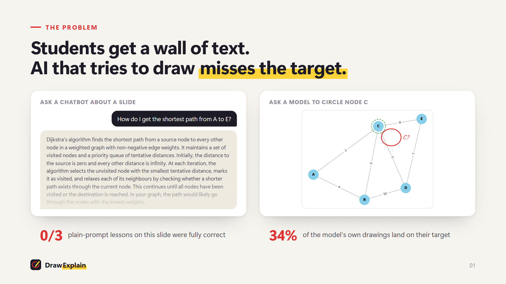
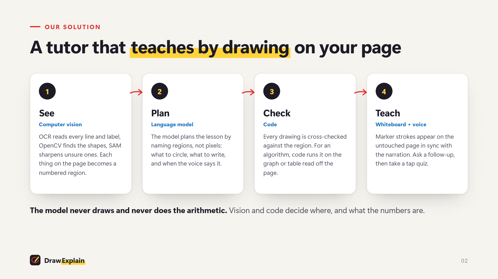
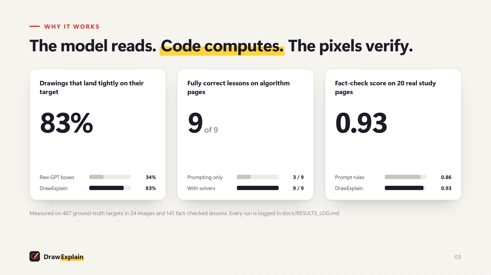
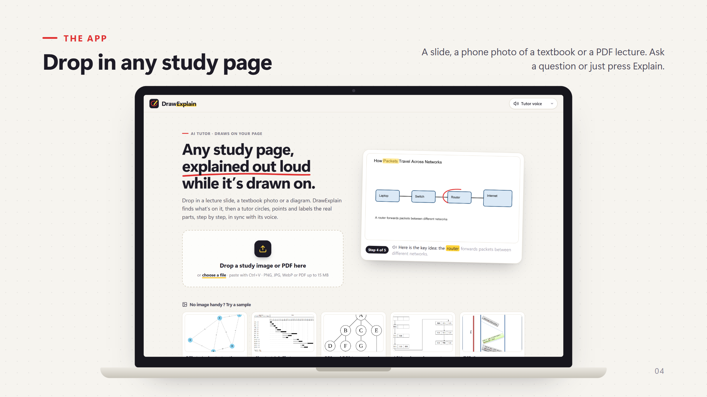
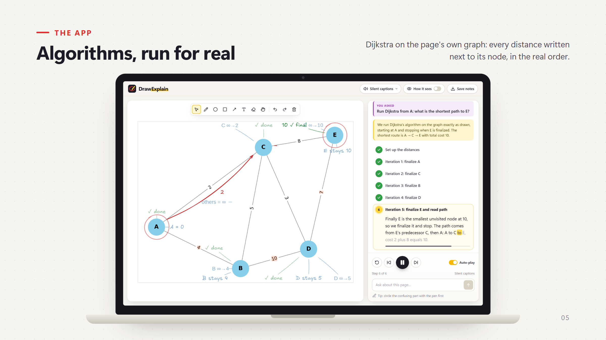
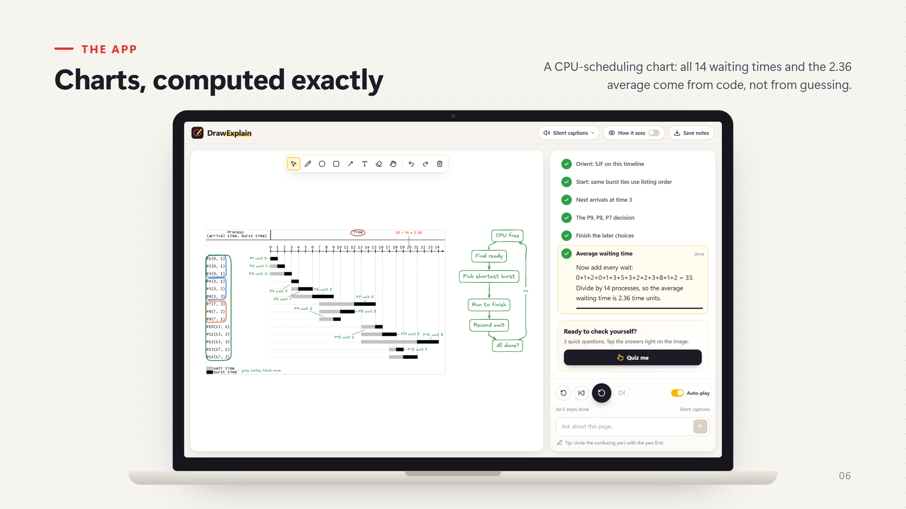
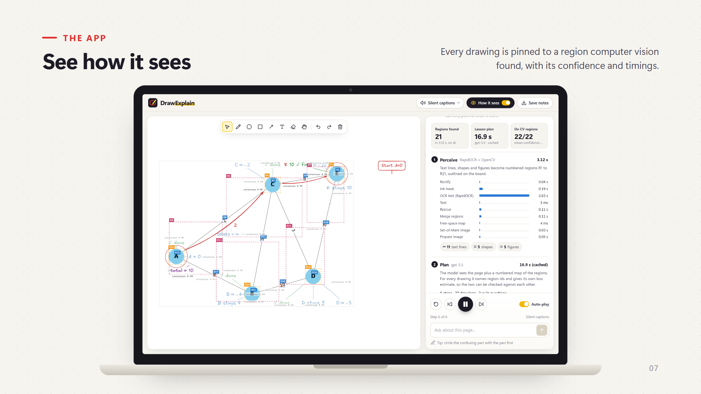
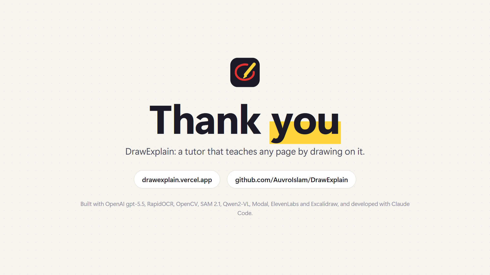

# DrawExplain

An AI tutor that teaches any study page by drawing on it. Upload a lecture slide, a phone photo of a
textbook or a PDF, ask a question (or just press Explain), and DrawExplain explains the page step by
step: it circles the right parts, writes the working next to them and talks you through it, like a
teacher at a whiteboard.

- Live app: https://drawexplain.vercel.app
- Demo video: _link coming_
- Built for Banana Hacks 2026 (image AI)



## The problem

When a slide does not make sense, a chatbot answers with a wall of text that never points at anything.
And when an AI tries to draw on the page itself, its coordinates are almost right: circles miss the
node, labels cover the text. We measured it: raw GPT boxes land tightly on their target only 34% of the
time. On algorithm slides, models also take shortcuts: asked about Dijkstra, plain prompting never ran
the algorithm correctly (0 of 3 runs).

## Our solution



DrawExplain splits the job so each part does what it is good at:

1. **See (computer vision).** OCR reads every line and label, OpenCV finds shapes, and on the optional GPU
   service SAM 2.1 sharpens unsure shapes and a vision model reads formulas as LaTeX. Every element on
   the page becomes a numbered region.
2. **Plan (language model).** gpt-5.5 plans the lesson by naming regions ("circle R7"), never pixel
   coordinates, and says when in the narration each drawing appears.
3. **Check (code).** Each drawing is cross-checked against the region it names. When the page shows an
   algorithm (graph search, spanning trees, sorting, binary search, TCP congestion control, CPU
   scheduling, page replacement), the model only reads the data off the page, the pixels confirm it,
   and code runs the algorithm. The numbers on the board come from code.
4. **Teach (whiteboard and voice).** Marker strokes are drawn on the untouched page in sync with an
   ElevenLabs voice. You can circle a part and ask a follow-up, then take a quiz by tapping the image.

## Why it works



| What we measured | Before | DrawExplain |
|---|---|---|
| Drawings that land tightly on their target (407 targets, 24 images) | 34% (raw GPT boxes) | 83% |
| Fully correct lessons on hard algorithm pages (3 pages, 3 runs each) | 3 of 9 (prompting only) | 9 of 9 |
| Fact-check score on 20 real study pages (core + 17 Wikimedia Commons pages) | 0.86 (prompt rules) | 0.93 |

Every number comes from scripts in `backend/scripts/` and is written up, including what went wrong, in
[docs/RESULTS_LOG.md](docs/RESULTS_LOG.md). Lesson scores are automatic fact checks on real lessons;
every failed check was read by hand.

## Screenshots






## Features

- Explain with or without your own question; every drawing appears when the voice mentions it.
- Algorithms and procedures are run on the page's own example, with every changed value on the board.
- PDF reader mode: turn pages freely; only the page you ask about is scanned, and earlier pages give context.
- Follow-up questions: circle the confusing part with the pen and ask.
- Tap quiz, "How it sees" view of the regions and timings, and Save notes as a PNG.
- Ten example pages to try, from Dijkstra and CPU scheduling to circuits and the Calvin cycle.

## Run it locally

Requirements: Python 3.12, Node 20+, an OpenAI API key. An ElevenLabs key is optional (the browser
voice is used without it), and so is the GPU service.

```bash
# .env in the repo root
OPENAI_API_KEY=...
ELEVENLABS_API_KEY=...        # optional
GPU_URL=...                   # optional, see backend/gpu/modal_app.py
GPU_KEY=...

cd backend
python -m venv .venv
.venv/Scripts/python -m pip install -r requirements.txt      # bin/ instead of Scripts/ on macOS and Linux
.venv/Scripts/python -m uvicorn app.main:app --port 8000

cd ../frontend
npm install
npm run dev                   # http://localhost:5173
```

Tests: `cd backend && .venv/Scripts/python -m pytest` (89 tests, no network).

Deployment: the API runs from the root `Dockerfile` on Render (`render.yaml`), the frontend on Vercel
with `VITE_API_BASE` pointing at the API.

## Project structure

```
backend/app/perception/   OCR, shapes, label rescue, photo flattening, free space, GPU client
backend/app/tutor/        prompts, lesson planner, grounding, geometry, validator
backend/app/tutor/solvers/  reads algorithm data off the page, checks it, runs the algorithm
backend/gpu/              GPU service on Modal (SAM 2.1, formula OCR)
backend/scripts/          evaluation scripts (grounding, lessons, formula OCR)
frontend/src/             React app and the Excalidraw whiteboard engine
samples/                  example pages, benchmark cases and evaluation results
docs/                     results log, write-up, demo script, graphics
```

## Built with

OpenAI gpt-5.5, RapidOCR (PP-OCRv4), OpenCV, SAM 2.1 and Qwen2-VL on Modal, ElevenLabs, FastAPI,
PyMuPDF, React, Vite, Excalidraw and lucide icons. Benchmark images come from Wikimedia Commons; sources
and licenses are in [samples/bench/SOURCES.md](samples/bench/SOURCES.md).

DrawExplain was developed with **Claude Code**, Anthropic's AI coding assistant, which we used to write
and test the code, run the evaluations and prepare these docs.


